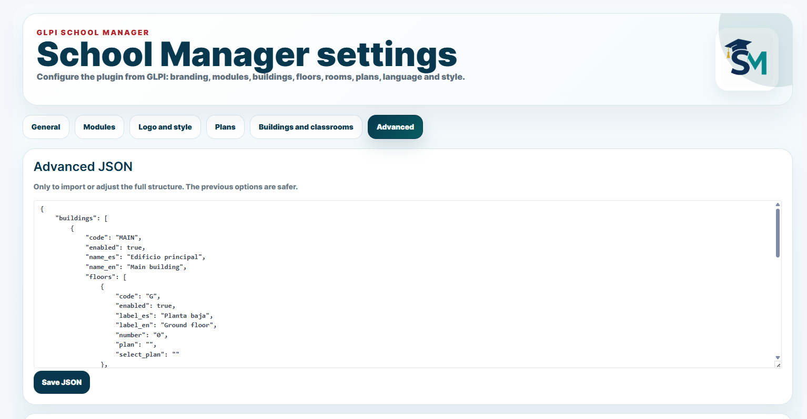

<p align="center">
  
</p>

<h1 align="center">School Manager pour GLPI</h1>

<p align="center">
  Plugin GLPI dédié aux établissements scolaires : création guidée d'incidents et d'actifs, stock informatique, plans interactifs et interface adaptée au mobile.
</p>

<p align="center">
  <a href="README.md">English</a> ·
  <a href="README_ES.md">Español</a> ·
  <b>Français</b> ·
  <a href="README_DE.md">Deutsch</a> ·
  <a href="README_IT.md">Italiano</a> ·
  <a href="README_PT.md">Português</a> ·
  <a href="#apercu">Aperçu</a> ·
  <a href="#langues">Langues</a> ·
  <a href="#prerequis">Prérequis</a> ·
  <a href="#installation">Installation</a> ·
  <a href="#captures">Captures</a> ·
  <a href="#documentation">Documentation</a> ·
  <a href="CREDITS.md">Crédits</a>
</p>

<p align="center">
  
  
  
  
</p>

<p align="center">
  <a href="https://github.com/pabloburgos/glpi-schoolmanager-plugin/actions/workflows/ci.yml">
    
  </a>
</p>

> School Manager est un plugin non officiel pour GLPI. Il n'est pas maintenu par l'équipe officielle de GLPI.

<a id="apercu"></a>

## Aperçu

School Manager ajoute une interface simplifiée et intuitive au-dessus de GLPI pour les écoles, collèges, lycées et centres de formation. GLPI reste le moteur central de gestion de parc et ITSM, tandis que School Manager fournit des écrans clairs sur ordinateur et mobile pour les enseignants, les techniciens et les administrateurs.

## Fonctionnalités principales

| Domaine | Description |
|---|---|
| Création guidée d'incidents (`new_ticket.php`) | Signalement pas-à-pas avec barre d'étapes adaptative sur mobile, sélection de catégorie, de salle, d'urgence et d'équipement concerné. |
| Création guidée d'actifs (`new_asset.php`) | Changement instantané de type d'équipement (ordinateurs, écrans, imprimantes, réseau, périphériques) et suivi de progression mobile. |
| Tableau de bord TIC (`it_panel.php`) | Espace de travail technique pour le suivi, l'attribution automatique et la résolution des demandes. |
| Gestion des stocks (`stock.php`) | Consommables, cartouches, mouvements de stock, alertes de seuil bas et pièces liées aux tickets. |
| Salles et plans (`classrooms.php`, `selector.php`) | Bâtiments, étages, salles de classe, plans interactifs `diagrams.net` (`draw.io`) et **mode liste seule** activable sans plans. |
| Activation et paramètres (`install.php`, `settings.php`) | Assistant dédié d'installation/mise à jour et centre de configuration unifié (logo, système visuel Navy & Teal, modules, langues et structure). |

<a id="langues"></a>

## Langues et Internationalisation (i18n)

GLPI School Manager intègre **6 langues officielles natives** (couverture 100 % sur 495 clés) avec **l'anglais (`en_GB`)** comme langue source principale :

| Langue | Code | Statut | Couverture |
|---|---|---|---|
| 🇬🇧 **English** | `en_GB` | Natif (Base standard & modèle) | 100% |
| 🇪🇸 **Español** | `es_ES` | Natif | 100% |
| 🇫🇷 **Français** | `fr_FR` | Natif | 100% |
| 🇩🇪 **Deutsch** | `de_DE` | Natif | 100% |
| 🇮🇹 **Italiano** | `it_IT` | Natif | 100% |
| 🇵🇹 **Português** | `pt_PT` | Natif | 100% |

### Centre de langues et éditeur visuel intégré dans GLPI

Aucun accès au serveur ou modification de code n'est requis ! Depuis **GLPI > Outils > School Manager > Paramètres > 🌐 Langues** :
- **Détection automatique** : S'adapte instantanément à la langue de votre session GLPI, avec repli transparent sur l'anglais.
- **Éditeur visuel dans le navigateur** : Modifiez n'importe quel texte directement à l'écran grâce à un filtre de recherche en temps réel et un enregistrement immédiat.
- **Téléchargement du modèle officiel (`template.php`)** : Téléchargez le modèle en anglais de 495 clés avec une consigne optimisée pour la traduction par IA (ChatGPT, Claude, Gemini).
- **Importation de fichiers de langue** : Importez vos fichiers `.php` ou `.json` personnalisés (ex. `ca_ES`, `pt_BR`). Le plugin les intègre automatiquement à la liste des langues.

<a id="prerequis"></a>

## Prérequis

| Composant | Recommandé |
|---|---|
| GLPI | 10.x ou 11.x |
| PHP | 8.x |
| Serveur Web | Apache recommandé |
| Base de données | Même base que celle de GLPI |
| Système d'exploitation | Linux recommandé |
| Navigateur | Chrome, Firefox, Edge ou Safari récents |
| Droits | Accès administrateur GLPI pour l'installation |

Le répertoire du plugin doit être obligatoirement nommé :

```text
schoolmanager
```

Chemin final sur le serveur :

```text
/var/www/glpi/plugins/schoolmanager
```

<a id="installation"></a>

## Installation et mise à jour

Exécutez cette commande sur le serveur GLPI :

```bash
sudo bash -c "$(curl -fsSL https://raw.githubusercontent.com/pabloburgos/glpi-schoolmanager-plugin/main/scripts/install-or-update.sh)"
```

Videz ensuite le cache GLPI et rechargez Apache :

```bash
cd /var/www/glpi
sudo -u www-data php bin/console cache:clear
sudo systemctl restart apache2
```

Rafraîchissez votre navigateur avec `Ctrl + F5`.

<a id="captures"></a>

## Captures d'écran

### Tableau de bord


### Configuration


### Création guidée d'incidents


### Gestion des stocks


### Salles de classe


### Plans


<a id="documentation"></a>

## Documentation

| Document | Description |
|---|---|
| [docs/INSTALLATION.md](docs/INSTALLATION.md) | Guide d'installation et de mise à jour. |
| [docs/CONFIGURATION.md](docs/CONFIGURATION.md) | Guide de configuration du plugin. |
| [docs/COMPATIBILITY.md](docs/COMPATIBILITY.md) | Notes de compatibilité GLPI & PHP. |
| [docs/PAGES.md](docs/PAGES.md) | Pages PHP principales. |
| [docs/STRUCTURE.md](docs/STRUCTURE.md) | Structure du dépôt. |
| [CONTRIBUTING.md](CONTRIBUTING.md) | Guide de contribution et traductions. |
| [SECURITY.md](SECURITY.md) | Politique de sécurité. |
| [CREDITS.md](CREDITS.md) | Auteurs et remerciements. |
| [CHANGELOG.md](CHANGELOG.md) | Historique des versions. |

## Auteurs

- **Pablo Burgos** (<pabloburgostena@faltax.app>)
- **Alejandro Galán**

## Licence

School Manager est distribué sous la licence GNU General Public License v3.0 ou ultérieure.

SPDX-License-Identifier: `GPL-3.0-or-later`

Consultez [LICENSE](LICENSE).
