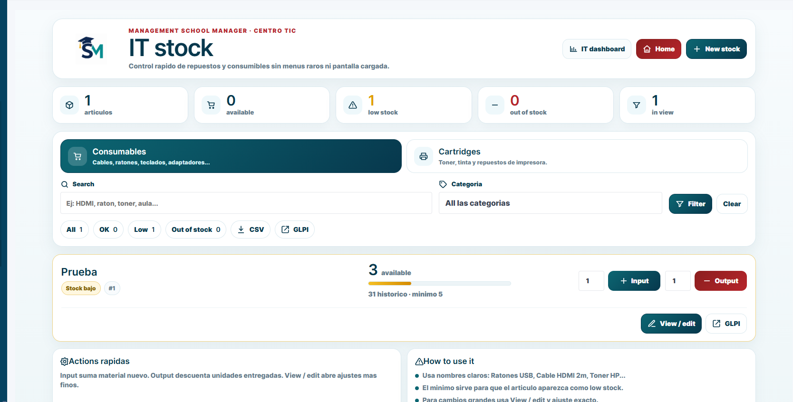
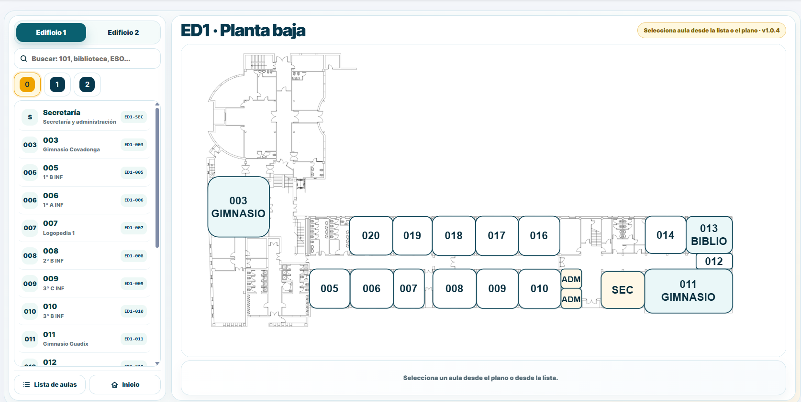

<p align="center">
  
</p>

<h1 align="center">School Manager per GLPI</h1>

<p align="center">
  Plugin GLPI per istituti scolastici ed educativi: creazione guidata ticket e risorse, magazzino IT, planimetrie interattive e gestione ottimizzata anche su mobile.
</p>

<p align="center">
  <a href="README.md">English</a> ·
  <a href="README_ES.md">Español</a> ·
  <a href="README_FR.md">Français</a> ·
  <a href="README_DE.md">Deutsch</a> ·
  <b>Italiano</b> ·
  <a href="README_PT.md">Português</a> ·
  <a href="#panoramica">Panoramica</a> ·
  <a href="#lingue">Lingue</a> ·
  <a href="#requisiti">Requisiti</a> ·
  <a href="#installazione">Installazione</a> ·
  <a href="#screenshot">Screenshot</a> ·
  <a href="#documentazione">Documentazione</a> ·
  <a href="CREDITS.md">Crediti</a>
</p>

<p align="center">
  
  
  
  
</p>

<p align="center">
  <a href="https://github.com/pabloburgos/glpi-schoolmanager-plugin/actions/workflows/ci.yml">
    
  </a>
</p>

> School Manager è un plugin non ufficiale per GLPI. Non è gestito né affiliato al progetto ufficiale GLPI.

<a id="panoramica"></a>

## Panoramica

School Manager arricchisce GLPI con un'interfaccia chiara e responsive per scuole, istituti comprensivi, licei e accademie. GLPI rimane la piattaforma centrale di ITSM e inventario, mentre School Manager offre flussi essenziali su desktop e smartphone per docenti, tecnici IT e amministratori.

## Funzionalità principali

| Area | Descrizione |
|---|---|
| Creazione guidata ticket (`new_ticket.php`) | Segnalazione guasti passo-passo con stepper mobile compatto, selezione di categoria, aula, urgenza e dispositivo interessato. |
| Creazione guidata risorse (`new_asset.php`) | Cambio istantaneo tra tipi di dispositivo (PC, monitor, stampanti, rete, periferiche) e barra di avanzamento mobile. |
| Dashboard IT (`it_panel.php`) | Area di lavoro per tecnici e personale IT per presa in carico, assegnazione automatica e risoluzione degli interventi. |
| Gestione magazzino (`stock.php`) | Materiali di consumo, cartucce, movimenti di carico/scarico, soglie minime e pezzi associati ai ticket. |
| Aule e planimetrie (`classrooms.php`, `selector.php`) | Edifici, piani, aule, mappe interattive `diagrams.net` (`draw.io`) e **modalità Solo Elenco** attivabile senza planimetrie. |
| Attivazione e impostazioni (`install.php`, `settings.php`) | Procedura iniziale per installazione/aggiornamento e pannello unificato (logo, stile Navy & Teal, moduli, lingue e struttura). |

<a id="lingue"></a>

## Lingue e Internazionalizzazione (i18n)

GLPI School Manager integra **6 lingue ufficiali native** (copertura al 100% su 495 chiavi), con **l'inglese (`en_GB`)** come lingua base di riferimento:

| Lingua | Codice | Stato | Copertura |
|---|---|---|---|
| 🇬🇧 **English** | `en_GB` | Nativo (Base standard & modello) | 100% |
| 🇪🇸 **Español** | `es_ES` | Nativo | 100% |
| 🇫🇷 **Français** | `fr_FR` | Nativo | 100% |
| 🇩🇪 **Deutsch** | `de_DE` | Nativo | 100% |
| 🇮🇹 **Italiano** | `it_IT` | Nativo | 100% |
| 🇵🇹 **Português** | `pt_PT` | Nativo | 100% |

### Centro Lingue ed Editor Visuale Integrato in GLPI

Nessun bisogno di modificare codice o accedere al terminale! Da **GLPI > Strumenti > School Manager > Impostazioni > 🌐 Lingue**:
- **Rilevamento automatico**: Si adatta alla lingua della sessione GLPI corrente, con fallback trasparente all'inglese.
- **Editor visuale nel browser**: Modifica qualsiasi stringa direttamente a schermo con ricerca in tempo reale e salvataggio istantaneo.
- **Download modello ufficiale (`template.php`)**: Scarica il modello in inglese con tutte le 495 chiavi e un prompt pronto per la traduzione con IA (ChatGPT, Claude, Gemini).
- **Caricamento pacchetti personalizzati**: Carica file `.php` o `.json` personalizzati (es. `ca_ES`, `pt_BR`). Il plugin li rileva e li rende subito disponibili.

<a id="requisiti"></a>

## Requisiti

| Componente | Raccomandato |
|---|---|
| GLPI | 10.x o 11.x |
| PHP | 8.x |
| Web server | Apache consigliato |
| Database | Stesso database di GLPI |
| Sistema operativo | Linux consigliato |
| Browser | Chrome, Firefox, Edge o Safari recenti |
| Permessi | Accesso amministratore GLPI per installazione |

La cartella del plugin deve chiamarsi esattamente:

```text
schoolmanager
```

Percorso sul server:

```text
/var/www/glpi/plugins/schoolmanager
```

<a id="installazione"></a>

## Installazione e aggiornamento

Esegui questo comando sul server GLPI:

```bash
sudo bash -c "$(curl -fsSL https://raw.githubusercontent.com/pabloburgos/glpi-schoolmanager-plugin/main/scripts/install-or-update.sh)"
```

Svuota la cache di GLPI e riavvia Apache:

```bash
cd /var/www/glpi
sudo -u www-data php bin/console cache:clear
sudo systemctl restart apache2
```

Ricarica il browser con `Ctrl + F5`.

<a id="screenshot"></a>

## Screenshot

### Dashboard


### Configurazione


### Ticket guidati


### Magazzino


### Aule


### Mappe


<a id="documentazione"></a>

## Documentazione

| Documento | Descrizione |
|---|---|
| [docs/INSTALLATION.md](docs/INSTALLATION.md) | Guida all'installazione e all'aggiornamento. |
| [docs/CONFIGURATION.md](docs/CONFIGURATION.md) | Guida alle impostazioni del plugin. |
| [docs/COMPATIBILITY.md](docs/COMPATIBILITY.md) | Note di compatibilità GLPI e PHP. |
| [docs/PAGES.md](docs/PAGES.md) | Pagine PHP principali. |
| [docs/STRUCTURE.md](docs/STRUCTURE.md) | Struttura del repository. |
| [CONTRIBUTING.md](CONTRIBUTING.md) | Linee guida per contributi e traduzioni. |
| [SECURITY.md](SECURITY.md) | Policy di sicurezza. |
| [CREDITS.md](CREDITS.md) | Autori e ringraziamenti. |
| [CHANGELOG.md](CHANGELOG.md) | Registro delle modifiche. |

## Autori

- **Pablo Burgos** (<pabloburgostena@faltax.app>)
- **Alejandro Galán**

## Licenza

School Manager è rilasciato sotto licenza GNU General Public License v3.0 o successiva.

SPDX-License-Identifier: `GPL-3.0-or-later`

Vedi [LICENSE](LICENSE).
