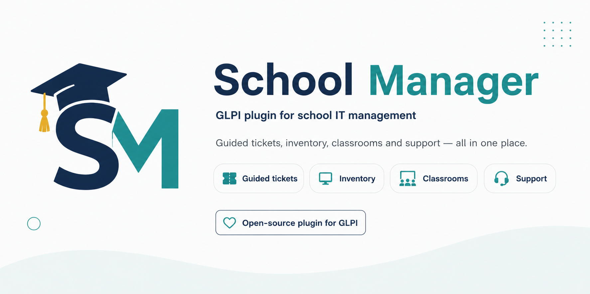

<p align="center">
  
</p>

<h1 align="center">School Manager para GLPI</h1>

<p align="center">
  Plugin de GLPI dedicado a escolas e centros educativos: criação guiada de pedidos e ativos, stock de TI, plantas interativas e fluxos otimizados para computador e telemóvel.
</p>

<p align="center">
  <a href="README.md">English</a> ·
  <a href="README_ES.md">Español</a> ·
  <a href="README_FR.md">Français</a> ·
  <a href="README_DE.md">Deutsch</a> ·
  <a href="README_IT.md">Italiano</a> ·
  <b>Português</b> ·
  <a href="#visao-geral">Visão geral</a> ·
  <a href="#idiomas">Idiomas</a> ·
  <a href="#requisitos">Requisitos</a> ·
  <a href="#instalacao">Instalação</a> ·
  <a href="#capturas">Capturas</a> ·
  <a href="#documentacao">Documentação</a> ·
  <a href="CREDITS.md">Créditos</a>
</p>

<p align="center">
  
  
  
  
</p>

<p align="center">
  <a href="https://github.com/pabloburgos/glpi-schoolmanager-plugin/actions/workflows/ci.yml">
    
  </a>
</p>

> O School Manager é um plugin não oficial para o GLPI. Não é mantido pela equipa oficial do GLPI.

<a id="visao-geral"></a>

## Visão geral

O School Manager adiciona uma camada operacional simplificada sobre o GLPI para escolas, agrupamentos e instituições de ensino. O GLPI mantém-se como a base ITSM e de inventário, enquanto o plugin oferece ecrãs claros em computador e telemóvel para professores, técnicos de informática e administradores.

## Funcionalidades principais

| Área | Descrição |
|---|---|
| Pedidos guiados (`new_ticket.php`) | Criação passo a passo com barra de progresso móvel, seleção por categoria, sala, prioridade e equipamento associado. |
| Registo guiado de ativos (`new_asset.php`) | Alternância instantânea entre tipos de ativo (computadores, monitores, impressoras, rede, periféricos) e barra inferior em telemóvel. |
| Painel TIC (`it_panel.php`) | Área técnica para pedidos em aberto, regras de atribuição automática, acompanhamento e resolução. |
| Controlo de stock (`stock.php`) | Consumíveis, tinteiros/toners, movimentos de stock, alertas de stock baixo e utilização associada a tickets. |
| Salas e plantas (`classrooms.php`, `selector.php`) | Edifícios, pisos, salas, plantas interativas `diagrams.net` (`draw.io`) e **modo Apenas Lista** ativável sem plantas. |
| Ativação e definições (`install.php`, `settings.php`) | Assistente dedicado pós-instalação/atualização e centro unificado de definições (logótipo, tema Navy & Teal, módulos, idiomas e estrutura). |

<a id="idiomas"></a>

## Idiomas e Internacionalização (i18n)

O GLPI School Manager inclui **6 idiomas oficiais nativos** (cobertura de 100% em 495 chaves), tendo o **Inglês (`en_GB`)** como idioma base principal:

| Idioma | Código | Estado | Cobertura |
|---|---|---|---|
| 🇬🇧 **English** | `en_GB` | Nativo (Base & modelo) | 100% |
| 🇪🇸 **Español** | `es_ES` | Nativo | 100% |
| 🇫🇷 **Français** | `fr_FR` | Nativo | 100% |
| 🇩🇪 **Deutsch** | `de_DE` | Nativo | 100% |
| 🇮🇹 **Italiano** | `it_IT` | Nativo | 100% |
| 🇵🇹 **Português** | `pt_PT` | Nativo | 100% |

### Centro de Idiomas e Editor Visual Integrado no GLPI

Sem necessidade de terminal ou edição de código! Em **GLPI > Ferramentas > School Manager > Definições > 🌐 Idiomas**, os administradores podem:
- **Deteção automática**: Deteta o idioma da sessão GLPI do utilizador, com fallback seguro para inglês.
- **Editor visual no navegador**: Edite ou traduza qualquer termo diretamente no ecrã com pesquisa em tempo real e gravação imediata.
- **Descarregar modelo oficial (`template.php`)**: Descarregue o modelo em inglês com 495 chaves e um prompt pronto para tradução com IA (ChatGPT, Claude, Gemini).
- **Carregar pacotes personalizados**: Carregue ficheiros `.php` ou `.json` personalizados (ex.: `pt_BR`, `ca_ES`). O plugin regista-os automaticamente.

<a id="requisitos"></a>

## Requisitos

| Componente | Suportado / recomendado |
|---|---|
| GLPI | 10.x ou 11.x |
| PHP | 8.x |
| Servidor Web | Apache recomendado |
| Base de dados | A mesma base utilizada pelo GLPI |
| Sistema operativo | Servidor Linux recomendado |
| Navegador | Chrome, Edge, Firefox ou Safari atualizados |
| Permissões | Acesso administrador GLPI para instalação e configuração |

A pasta do plugin deve chamar-se exatamente:

```text
schoolmanager
```

Caminho final:

```text
/var/www/glpi/plugins/schoolmanager
```

<a id="instalacao"></a>

## Instalação e atualização

Execute este comando no servidor GLPI:

```bash
sudo bash -c "$(curl -fsSL https://raw.githubusercontent.com/pabloburgos/glpi-schoolmanager-plugin/main/scripts/install-or-update.sh)"
```

De seguida limpe a cache e reinicie o Apache:

```bash
cd /var/www/glpi
sudo -u www-data php bin/console cache:clear
sudo systemctl restart apache2
```

Atualize o navegador com `Ctrl + F5`.

<a id="capturas"></a>

## Capturas de ecrã

### Painel principal


### Definições


### Pedidos guiados


### Controlo de stock


### Salas


### Plantas


<a id="documentacao"></a>

## Documentação

| Documento | Descrição |
|---|---|
| [docs/INSTALLATION.md](docs/INSTALLATION.md) | Guia de instalação e atualização. |
| [docs/CONFIGURATION.md](docs/CONFIGURATION.md) | Guia de configuração do plugin. |
| [docs/COMPATIBILITY.md](docs/COMPATIBILITY.md) | Notas de compatibilidade. |
| [docs/PAGES.md](docs/PAGES.md) | Páginas PHP principais. |
| [docs/STRUCTURE.md](docs/STRUCTURE.md) | Estrutura do repositório. |
| [CONTRIBUTING.md](CONTRIBUTING.md) | Guia de contribuição. |
| [SECURITY.md](SECURITY.md) | Política de segurança. |
| [CREDITS.md](CREDITS.md) | Créditos e agradecimentos. |
| [CHANGELOG.md](CHANGELOG.md) | Histórico de alterações. |

## Autores

- **Pablo Burgos** (<pabloburgostena@faltax.app>)
- **Alejandro Galán**

## Licença

O School Manager é distribuído sob a licença GNU General Public License v3.0 or later.

SPDX-License-Identifier: `GPL-3.0-or-later`

Consulte [LICENSE](LICENSE).
